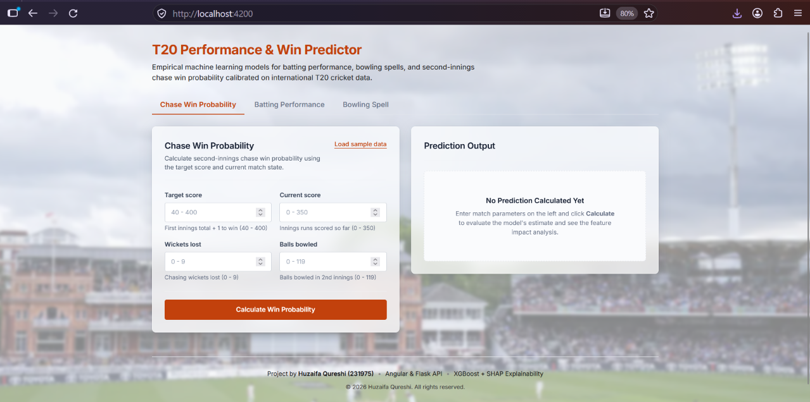
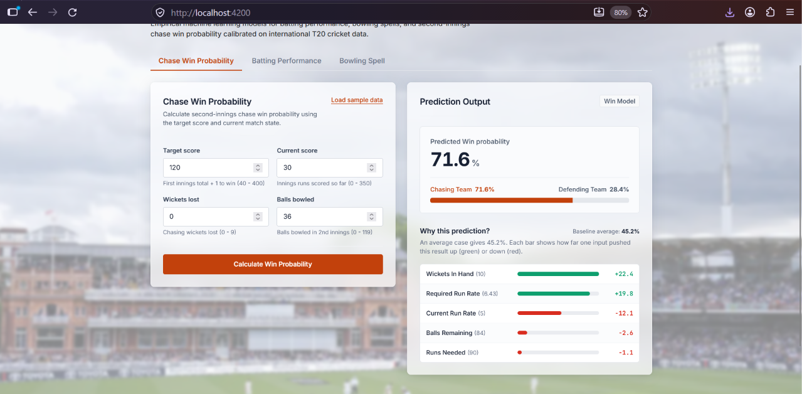
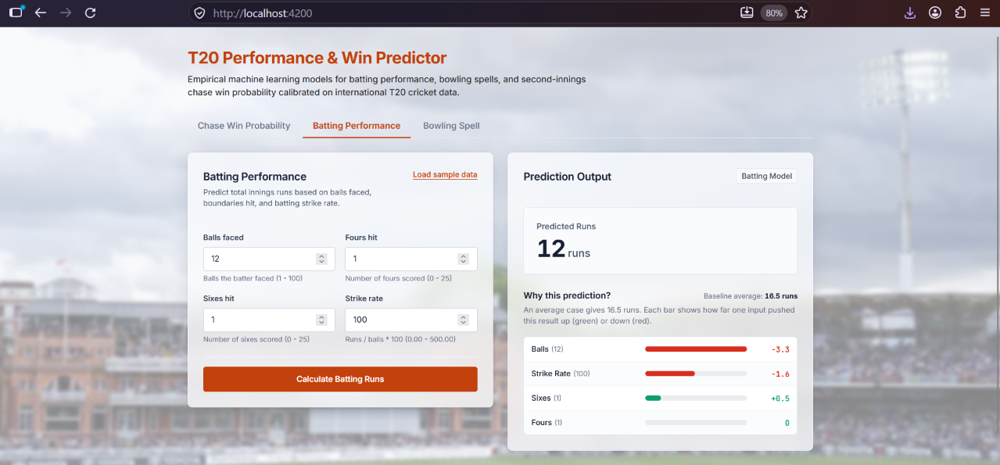
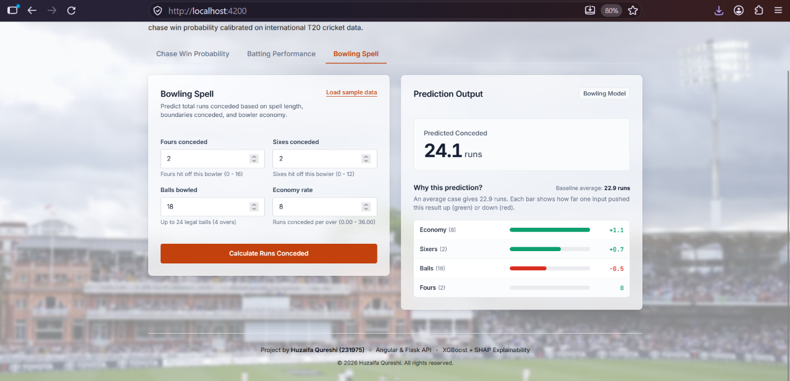

# T20 Performance and Win Predictor
Huzaifa Qureshi - 231975 - BSSE 7A
Supervised by: Mr. Ali Pirzada

[](https://github.com/muhammad-huzaifa-qureshi/t20-predictor/actions/workflows/ci.yml)
[](https://github.com/muhammad-huzaifa-qureshi/t20-predictor/actions/workflows/deploy.yml)

Machine learning models for international T20 cricket, served through a Flask API and an Angular frontend.

**Live demo (static page only):** https://muhammad-huzaifa-qureshi.github.io/t20-predictor/

**What this project shows:**

- Replication of a published research paper, plus a new model (XGBoost) that goes beyond it
- A live chase win probability model with per prediction explanations (SHAP values)
- Full stack application: Flask API and Angular frontend
- Automated tests and CI/CD with GitHub Actions

## Screenshots









## Dataset

Ball by ball international T20 (IT20) data from Kaggle: [IT20 Cricket Data (2003 to 2023)](https://www.kaggle.com/datasets/jamiewelsh2/ball-by-ball-it20).

| Property | Value |
| --- | --- |
| Source | [Kaggle Dataset](https://www.kaggle.com/datasets/jamiewelsh2/ball-by-ball-it20) |
| File | `dataset/ball_by_ball_it20.csv` |
| Rows | About 425,119 |
| Matches | About 1,842 |
| Period | 2003 to 2023 |
| Columns | 35 |

## Approach

### Part A: paper replication

I reproduced the paper "Predicting players' performance in T20 cricket matches using Machine Learning approaches" (Thilakarathne, 2024). The paper is included in `paper/Predicting_Players_Performacne.pdf`.

**Batting** predicts Runs from Balls, Fours, Sixes and Strike Rate.
**Bowling** predicts Runs Conceded from Fours, Sixers, Balls and Economy.

Paper models: Linear Regression and Random Forest.
Metrics: RSE (R squared) and MSE on train and test splits.

I rebuilt the per player tables from raw ball by ball data and compared my numbers with the paper's Table 4. I then added XGBoost, which is the model the app serves for batting and bowling predictions.

**Results (train and test splits):**

| Section | Model | RSE (train) | MSE (train) | RSE (test) | MSE (test) |
| --- | --- | --- | --- | --- | --- |
| Batting | Linear Regression | 0.9732 | 9.4753 | 0.9753 | 9.1075 |
| Batting | Random Forest | 0.9999 | 0.0504 | 0.9993 | 0.2502 |
| Batting | XGBoost | 0.9994 | 0.1967 | 0.9991 | 0.3212 |
| Bowling | Linear Regression | 0.9130 | 9.6535 | 0.9214 | 9.2116 |
| Bowling | Random Forest | 0.9997 | 0.0294 | 0.9982 | 0.2085 |
| Bowling | XGBoost | 0.9992 | 0.0843 | 0.9990 | 0.1133 |

**Comparison with the paper (Table 4, test set):**

| Section | Model | Paper RSE | My RSE | Paper MSE | My MSE |
| --- | --- | --- | --- | --- | --- |
| Batting | Linear Regression | 0.9551 | 0.9753 | 6.6149 | 9.1075 |
| Batting | Random Forest | 0.9941 | 0.9993 | 1.5066 | 0.2502 |
| Bowling | Linear Regression | 0.8898 | 0.9214 | 9.8721 | 9.2116 |
| Bowling | Random Forest | 0.9098 | 0.9982 | 5.1478 | 0.2085 |

Differences from the paper are expected because the paper used a pre-aggregated table, while I rebuilt the player figures from raw ball by ball records.

**What I noticed:** Strike Rate is `Runs / Balls * 100` and Economy is `Conceded / Overs`. Each of these predictors already contains the target, so R squared near 0.999 is partly built in. The models are accurate, but they do not forecast anything that could not already be computed. I kept these inputs for faithfulness to the paper and addressed the issue in Part B.

### Part B: live chase win probability (my extension)

**Question.** The team batting second needs a target. At any ball of the chase, what is their chance of winning? This is the win bar shown on TV broadcasts.

**Inputs the user types:** target, current score, wickets lost, balls bowled.

**Derived model features:** Runs Needed, Balls Remaining, Wickets In Hand, Current Run Rate, Required Run Rate.

**Data and label.** Second innings rows only. The label is whether the chasing team won. The model is an XGBoost classifier, compared with a logistic regression baseline.

**No leakage.** Only information known at that ball is used. No Winner or outcome column is an input.

**Train/test split by match.** All balls of one chase are strongly related. A row based split would inflate scores by letting the model see parts of the same chase during training. I split by match instead.

**Why Target Score is not an input.** It is the same number for every ball of a chase, so the trees used it like a match ID and memorized results (about 57% accuracy on unseen matches in my first version). Removing it and adding shallow trees, large minimum leaf size, and monotone constraints (more runs needed can never help the chasing team, more wickets in hand can never hurt it) fixed that. Runs Needed already carries the target information in a way that changes ball by ball.

**Validation.** The notebook reports accuracy, ROC AUC, log loss and Brier score. It shows train and test log loss side by side to check for memorization. It includes a data check section (labels match how each chase really ended, Runs to Get equals target minus runs, each input's own AUC, scores on 5 different match splits). It also plots win probability across one unseen match with wickets marked.

**Results (test set):**

| Model | Accuracy | ROC AUC | Log loss | Train log loss |
| --- | --- | --- | --- | --- |
| XGBoost | 0.8108 | 0.9054 | 0.4103 | 0.3502 |
| Logistic regression baseline | 0.8110 | 0.9067 | 0.4078 | 0.3698 |

The two models perform about the same. The value of this work is the live win probability with a per prediction explanation, not a large accuracy gap. I use XGBoost because it returns SHAP explanation values natively and handles nonlinear cases.

## Explainable AI

SHAP values show how much each input pushed a prediction up or down from the average case.

The "average case" (stored in the model, 45.2% for the win model) is the starting point the bars move away from, and the pieces add up to the prediction. For example, Required Run Rate might contribute +17 percentage points.

The notebook has SHAP bar and beeswarm charts for the win model (sections 12 and 13 in `notebooks/model_training.ipynb`).

The API returns these values for all three models. XGBoost computes them itself with `pred_contribs`, so the backend needs no extra library. For win probability they are converted from log odds into percentage points so they are easy to read.

The UI shows a "Why this prediction?" card with one bar per input. Green pushes the prediction up and red pushes it down.

## Architecture

```text
notebooks/model_training.ipynb
  └── Trains models, exports JSON files
        ├── batting_model.json
        ├── bowling_model.json
        └── win_model.json

backend/app.py  (Flask API, port 5000)
  ├── Loads the three model JSON files from backend/models/
  ├── Accepts POST requests, runs prediction, computes SHAP explanations
  └── Returns prediction + base + contributions as JSON

frontend/  (Angular app, port 4200)
  ├── Three tabs: Chase Win Probability, Batting Performance, Bowling Spell
  ├── Win probability tab shows chasing team vs defending team bar
  ├── All tabs show a "Why this prediction?" card with SHAP contribution bars
  ├── Input hints guide the user on valid ranges
  └── UI colors come from design tokens in frontend/src/styles.css
```

The Angular dev server proxies `/api/*` requests to Flask on port 5000 through `frontend/proxy.conf.json`.

## API reference

### `GET /health`

```json
{ "status": "ok", "models": ["batting", "bowling", "win"] }
```

### `POST /predict/batting`

Request:

```json
{ "balls": 20, "fours": 3, "sixes": 2, "strike_rate": 150 }
```

### `POST /predict/bowling`

Request:

```json
{ "fours": 3, "sixes": 1, "balls": 24, "economy": 8 }
```

### `POST /predict/win`

Request:

```json
{ "target": 180, "score": 95, "wickets": 2, "balls_bowled": 66 }
```

### Response format (all three endpoints)

```json
{
  "model": "win",
  "target": "Win probability",
  "prediction": 68.3,
  "unit": "%",
  "base": 45.2,
  "contributions": [
    { "label": "Required Run Rate", "input": 9.44, "value": 17.1 },
    { "label": "Wickets In Hand", "input": 8, "value": 5.3 },
    { "label": "Runs Needed", "input": 85, "value": -2.8 }
  ]
}
```

The `base` value is the model's average case prediction. Each contribution shows how much one input pushed the prediction up (positive) or down (negative). The contributions plus the base add up to the prediction.

For batting and bowling the `unit` is `"runs"`. For win probability the `unit` is `"%"`.

**Errors.** Missing, extra, non numeric or out of range fields return HTTP 400 with an `error` message. An unknown model name returns 404.

## Testing and CI/CD

### Tests

The backend has 8 tests in `backend/tests/test_api.py`:

1. `test_health` checks the health endpoint returns status ok
2. `test_batting_prediction` checks that batting predictions are in a sane range
3. `test_bowling_prediction` checks that bowling predictions are in a sane range
4. `test_missing_field_returns_400` checks validation rejects missing fields
5. `test_out_of_range_returns_400` checks validation rejects out of range values
6. `test_unknown_model_returns_404` checks that an unknown model returns 404
7. `test_win_prediction_and_explanation` checks the win probability endpoint, verifies the unit is `%`, and asserts that `base + sum(contributions)` rebuilds the prediction within 0.5
8. `test_win_score_at_target_returns_400` checks that setting the score equal to the target returns 400

The model JSON files are versioned in the repo (`backend/models/`), so CI runs predictions against the real models.

### CI (`ci.yml`)

Runs on every push and pull request to `main`. Two jobs:

- **Backend (Flask):** sets up Python 3.14, installs `backend/requirements.txt`, checks syntax with `compileall`, runs pytest.
- **Frontend (Angular):** sets up Node 24 and pnpm 11, installs from the lock file, builds Angular.

### CD (`deploy.yml`)

Runs after CI succeeds on `main`. Builds Angular for production with the repository name as the base path and publishes it to GitHub Pages.

One time setup: in the repository, open Settings, then Pages, and set Source to **GitHub Actions**.

## Run locally

Use two terminals, both opened in the project root.

### Terminal 1: backend

```cmd
cd backend
python -m venv venv
venv\Scripts\activate.bat
python -m pip install -r requirements.txt
python app.py
```

Flask runs at http://127.0.0.1:5000. Open http://127.0.0.1:5000/health to confirm it is up. Leave this terminal running.

### Terminal 2: frontend

```cmd
cd frontend
pnpm install
pnpm start
```

Angular runs at http://localhost:4200. It forwards every `/api/...` request to Flask on port 5000 through `frontend/proxy.conf.json`.

If `pnpm install` stops with `ERR_PNPM_IGNORED_BUILDS`, run `pnpm approve-builds`, then `pnpm install` again.

### Run the tests

```cmd
cd backend
python -m pytest -q tests
cd ..\frontend
pnpm build
```

The backend command should end with `8 passed`. The build output is written to `frontend/dist/frontend/browser`.

## Limitations

- The GitHub Pages site is a static demo. Predictions need the Flask backend running locally.
- The win model assumes 20 over chases (120 balls).
- The Part A models (batting, bowling) keep the paper's input features that contain the target, so their high R squared scores are expected and do not reflect genuine forecasting skill.
- XGBoost and logistic regression perform about the same on win probability. The reason for choosing XGBoost is the built in SHAP explanation, not a large accuracy gap.

## Tech stack

| Layer | Tools |
| --- | --- |
| Models | Python, pandas, XGBoost (trained in `notebooks/model_training.ipynb`) |
| Backend | Flask |
| Frontend | Angular 22, TypeScript, CSS design tokens |
| Tooling | pnpm, pytest |
| CI and CD | GitHub Actions, GitHub Pages |

## Project structure

```text
t20-predictor/
├── .github/workflows/
│   ├── ci.yml              # backend tests and Angular build
│   └── deploy.yml          # publishes the Angular build to GitHub Pages
├── backend/
│   ├── app.py              # Flask API
│   ├── constants.py        # model specs, feature names, validation ranges
│   ├── requirements.txt
│   ├── models/             # batting_model.json, bowling_model.json, win_model.json
│   └── tests/test_api.py
├── dataset/
│   └── ball_by_ball_it20.csv
├── frontend/               # Angular app
│   ├── src/
│   │   ├── styles.css      # design tokens (colors, radii, shadows, fonts)
│   │   └── app/
│   │       ├── app.html    # template with tabs, form, result card, explanation card
│   │       ├── app.ts      # component logic
│   │       ├── app.css     # component styles
│   │       ├── constants.ts        # input ranges and hints
│   │       ├── model-config.ts     # model definitions (fields, examples, labels)
│   │       └── prediction.service.ts  # HTTP client for the API
│   ├── proxy.conf.json     # forwards /api to Flask during development
│   └── package.json
├── notebooks/
│   └── model_training.ipynb
├── paper/
│   └── Predicting_Players_Performacne.pdf
├── screenshots/
│   ├── First-View.png
│   ├── Win-Prediction.png
│   ├── Batting-Predict.png
│   └── Bowling-Predict.png
└── README.md
```

## Reference

H. M. D. Thilakarathne, "Predicting players' performance in T20 cricket matches using Machine Learning approaches," 2024.
Paper included in `paper/Predicting_Players_Performacne.pdf`.

Dataset: [Ball by Ball IT20 (2003 to 2023) on Kaggle](https://www.kaggle.com/datasets/jamiewelsh2/ball-by-ball-it20), stored locally as `dataset/ball_by_ball_it20.csv`.
